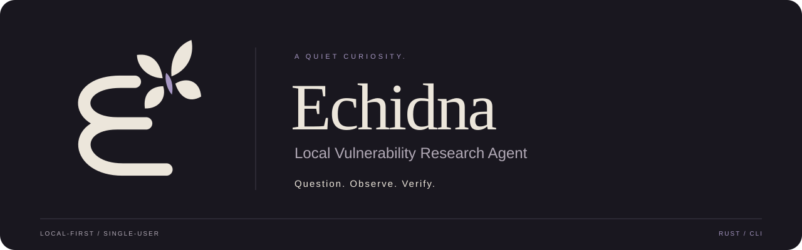
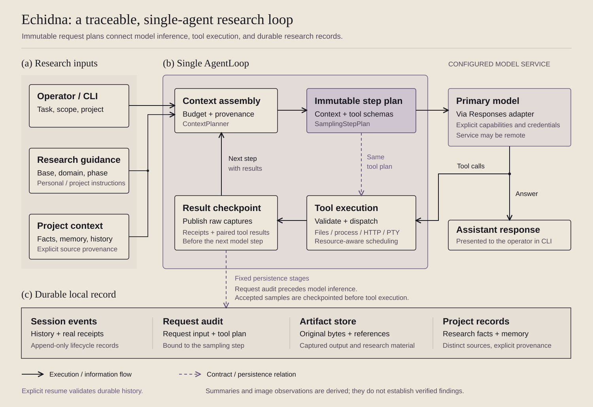

<p align="center">
  
</p>

<p align="center">
  <a href="README.md">简体中文</a> · <strong>English</strong>
</p>

<p align="center">
  <strong>Research locally. Keep every step traceable.</strong>
</p>

<p align="center">
  <a href="#system-design">System design</a> ·
  <a href="#capabilities">Capabilities</a> ·
  <a href="#quick-start">Quick start</a> ·
  <a href="#everyday-use">Everyday use</a> ·
  <a href="#next-steps">Next steps</a> ·
  <a href="#documentation">Documentation</a>
</p>

---

Echidna is a local-first vulnerability research agent for individual use. You define the
target, scope, and question. It works through file, command-line, and network tools,
keeping sessions, tool execution receipts, and research materials in the project so you
can continue the work, inspect the process, and export records.

Built in Rust with an interactive CLI, Echidna uses one AgentLoop for source code, web,
mobile, and binary research. Domain and phase guidance help organize the research method;
your environment provides the actual analysis tools.

## System design

Echidna couples a single research agent loop with an inspectable local record of its work.
The operator defines the task and scope; the runtime assembles context, requests model
inference, executes validated tool calls, and retains the observations needed to continue
or review the research.

[](assets/architecture-overview.svg)

*Figure 1. Echidna's execution and persistence model. (a) Operator input, research guidance,
and project context enter through distinct sources. (b) One AgentLoop binds model inference
and tool dispatch to an immutable sampling plan. (c) Fixed persistence stages retain session
events, request audits, original artifacts, and project records. The figure abstracts
individual failure paths and optional image routing; it does not depict future orchestration.*

**Plan once per sampling step.** Context assembly accounts for source provenance and the
available context budget. A captured `SamplingStepPlan` binds that context to the advertised
tool schemas and explicit model capabilities. The same resolved tool plan validates and
dispatches the model's tool calls, keeping model-visible tools and executable tools aligned.

**Checkpoint before dependent work.** Request auditing precedes inference. Accepted model
samples are checkpointed before dependent tool execution; raw process captures are published
before execution receipts, and paired tool results are checkpointed before the next model
step. Tool execution uses resource-aware scheduling inside the single agent loop.

**Retain observations; derive context.** Original artifacts and append-only events preserve
what was observed. Memory, summaries, caches, and image observations retain their own roles
and provenance; none automatically establishes a verified finding. Explicit session recovery
validates durable history before continuing, while unknown execution effects remain explicit.

This separation lets model capabilities and research methods evolve while execution,
request budgets, and recovery remain locally controlled. When configured, a secondary vision
provider follows a scoped auxiliary path within the same agent lifecycle. The runtime keeps
one agent loop and one session authority.

## Capabilities

| | What it does |
| --- | --- |
| **Analyze and execute** | Search and read code, edit files, apply patches, run commands, send HTTP requests, and use background jobs and PTYs. |
| **Continue research** | Retain project context and sessions, explicitly resume an existing session, and compact context for longer tasks when prerequisites are met. |
| **Intervene as you work** | Stop the current turn, add instructions or change direction in the terminal, and inspect actual tool progress and output. |
| **Inspect the record** | Review tool execution receipts, original material references, and request audits; export sessions as Markdown or JSON. |
| **Build on prior methods** | Use project Markdown memory and explicit personal/project instruction files to retain constraints, decisions, and unsuccessful approaches. |
| **Work with images** | Use the primary model or an optional vision model according to explicit configuration, retaining image sources and their links to observations. |

**Local-first** means project data and tool execution stay local. When you configure a remote
model, materials included in its requests are sent to that provider. Image support depends
on capability configuration; model observations and answers still require verification
against actual evidence.

## External Agent definitions (separate branch)

`codex/agent-definition-v1` externalizes persona, work instructions, and methods into local
files while retaining one execution loop. This branch is maintained separately and will
not merge into main. Research remains the default; the
[`technical-writing` example](examples/agents/technical-writing) provides a generic agent.

```sh
echidna agent init ./my-agent --id my-writer --from technical-writing
# Edit my-agent/persona.md, work.md, and the Markdown files under methods/.
echidna --config /path/to/provider.toml agent check ./my-agent
echidna --config /path/to/provider.toml agent inspect ./my-agent
echidna --config /path/to/provider.toml chat --agent ./my-agent
```

Use `--from builtin-research` to export the research template. `check` validates resources,
known tools, and static context budgets offline; runtime admission also checks task history
and current facts. `inspect` shows resolved instructions and tools, including your selected
personal/project instruction content.

The version-1 `agent.toml` contains:

| Setting | Meaning |
| --- | --- |
| `id` / `name` | Stable identity and display name. Content edits do not change memory identity. |
| `instructions` | Relative `persona_file`, `work_file`, and ordered `method_files`. |
| `context.personal` / `project` | `configured` snapshots the files selected in Provider config; `none` excludes them. |
| `context.memory` | `none`, `project`, or `agent`; Agent memory is scoped by project and stable ID. |
| `tools` | Known names mapped to `direct`, `deferred`, or `hidden`; omitted names are Hidden. Deferred tools require direct `tool_search`. |
| Optional `research` | Existing domain/phase selections and complete external prompt maps. Omission means no Research state or default Research events. |

For research definitions, Direct/Deferred are baseline exposure and existing Domain/Phase
rules may adjust them; Hidden stays terminal. Tool visibility controls context, not permission.
Generic image, HTTP, and artifact tools bind materials to the current Session without a fake Target.

The runtime supplies the current Agent ID and Memory scope to the model.
Logical Memory paths resolve within that scope. Missing documents return null
content/hash; create with expected_hash:null and update with the current hash
returned by memory_read. Version 2 of memory_read, memory_write and inspect_project
uses runtime operation timestamps and rejects caller occurred_at/observed_at
arguments. Historical sessions and source timestamps remain unchanged.

Inside chat, `/agent` displays identity and digest. `/agent reload [directory or agent.toml]`
reloads instructions for the same identity, keeps History, and rebuilds the Provider session.
`/agent use <path>` opens a new Session and leaves the old one resumable. Changes require
paired calls, no running/stopping Job or PTY, and no queued image. `/image cancel` detaches
a queued image while preserving its durable artifact.

Sessions pin complete instruction content. Editing or deleting source files does not change
an existing Session; Resume uses its saved content and reload explicitly reads new content.
Reload cannot change the ID, memory scope, or research contract; use a new Session for those
changes. Neither command automatically samples a model, continues a task, or replays tools.
New Sessions select `chat --agent`, then top-level config `agent_definition`, then builtin
research. Config paths resolve relative to that config file. Model and credential selection
remain independent. Older binaries cannot read the new definition events.

## Quick start

The current setup primarily targets macOS. Install Git and Rust/rustup; the repository pins
Rust 1.93.1 through [`rust-toolchain.toml`](rust-toolchain.toml).
Install external analysis tools as needed for your tasks.

### 1. Build

```sh
git clone https://github.com/F0und-icu/echidna-agent.git
cd echidna-agent
cargo build --locked --release

ECHIDNA_BIN="$PWD/target/release/echidna"
"$ECHIDNA_BIN" --version
```

Run the remaining commands in the same terminal, continuing to use `ECHIDNA_BIN`.

### 2. Configure a model

Choose a complete template for your setup and save it outside the source repository:

| Setup | Complete template | Image handling |
| --- | --- | --- |
| Text-only model | [provider.toml](examples/provider.toml) | `disabled`: no image input |
| One multimodal model | [provider-multimodal.toml](examples/provider-multimodal.toml) | `primary_direct`: the primary model receives images directly |
| Text primary + separate vision model | [provider-text-vision.toml](examples/provider-text-vision.toml) | `secondary_tool`: the vision model analyzes images; the primary continues with its observations |

The following copies the text-only template. For image support, replace the source file
in the copy command with the appropriate template:

```sh
mkdir -p "$HOME/.config/echidna"
cp -n examples/provider.toml "$HOME/.config/echidna/provider.toml"
chmod 600 "$HOME/.config/echidna/provider.toml"
```

Edit the file to set the service URL and model. Check the context window and
each declared capability against the service's actual support. The URL, model name, and 32K window
in the template are examples; `cp -n` preserves an existing file. The commands pass this
configuration path explicitly; the program does not discover it automatically.

The current integration uses **HTTP/SSE + Responses**. Chat Completions endpoints are not
supported. With separate models, both the primary and vision services must support this protocol.

#### Environment variables and keys

The templates read keys through `credential_ref`; service URLs, model names, and capability
declarations remain in TOML. Set the variables in the same terminal that will start Echidna:

```sh
export CYBER_AGENT_PRIMARY_API_KEY='replace-with-your-primary-key'
# Set this only when using a separate vision model.
export CYBER_AGENT_VISION_API_KEY='replace-with-your-vision-key'
```

The primary provider uses `credential_ref = "CYBER_AGENT_PRIMARY_API_KEY"`, and the vision
provider uses `credential_ref = "CYBER_AGENT_VISION_API_KEY"`. Each reads its own named variable;
there is no fallback to the other role's key or to `OPENAI_API_KEY`.
Custom names must follow `CYBER_AGENT_*_API_KEY` and contain only uppercase letters, digits,
and underscores.

The program **does not load `.env` files automatically**. If you maintain a trusted env file,
load it in your shell and export its variables before starting. Alternatively, replace
`credential_ref` with `api_key = "…"` in your local TOML; each provider must use exactly one.
Keep real keys and configuration outside the repository and out of Git.

#### ChatGPT subscription sign-in

Use the [subscription template](examples/provider-chatgpt-subscription.toml) and save your
configuration outside the repository. Set `auth_store` to an absolute private directory without symlinks and with an existing parent
and retain the official API URL. `chatgpt_subscription` is mutually exclusive with
`api_key` and `credential_ref`. Echidna performs its own OAuth authorization; it does not
read existing Codex or browser credentials.

```sh
echidna --config /absolute/path/subscription.toml auth login --provider chatgpt
echidna --config /absolute/path/subscription.toml auth status --provider chatgpt
echidna --config /absolute/path/subscription.toml auth models --provider chatgpt
```

Login opens a browser. Use `--no-browser` to open the printed authorization URL manually.
The browser must reach the loopback callback on the machine running Echidna; using a
different machine requires forwarding the callback port.
`status` checks local state only; `models` queries the server with the selected account.
Put a returned model slug in `model`, verify its capabilities and context window, then use
the same configuration for `doctor` and `chat`. The template's 32K window is an explicit
example. Subscription HTTP requires `incremental_input = false` and does not accept
`max_output_tokens`. Successful login and offline doctor do not prove model eligibility.

```sh
echidna --config /absolute/path/subscription.toml auth logout --provider chatgpt
```

Access tokens refresh on demand before use. Logout attempts revocation and removes local
tokens, reporting whether remote revocation was confirmed. Keep the authentication
directory outside repositories and research projects with owner-only directory/file access.
Account eligibility and usage follow the [official preview limitations](https://developers.openai.com/siwc/token-sharing-open-source/preview-limitations).
Failures do not switch to paid API access or replay tools. Other vendors' non-key
subscriptions are not yet supported.

#### Codex-compatible subscription sign-in

Use the [Codex-compatible template](examples/provider-codex-subscription.toml) with
explicit `codex_subscription` and `https://chatgpt.com/backend-api/codex`.
This choice is exclusive with SIWC and both API-key forms. Use a separate private
`auth_store` for this profile. Existing API-key, Qwen and DeepSeek configurations
need no changes.

To declare a catalog compatibility version, set
`catalog_client_version = "major.minor.patch"` inside `codex_subscription`. Its
default remains `0.144.0`; an explicit value changes only the catalog request's
`client_version` query and `version` header. It does not claim an installed Codex
release or guarantee new model IDs or account access.

Use the same `auth login/status/models/logout` commands above with the new config
path and its provider ID. Echidna performs its own browser authorization and owns
its token store; it does not read an existing Codex login. The loopback callback
uses port 1455, or 1457 when that port is occupied. If the catalog returns HTTP401
while local status still reports future expiry, explicitly refresh the own grant:

```sh
echidna --config /absolute/path/codex.toml auth refresh --provider codex
```

This Codex-only command refreshes credentials and returns local status. It opens
no browser and repeats no catalog/model request. After success, explicitly run
selection again; a permanently rejected refresh requires a new login. Local
`status` does not prove the backend still accepts the grant. SIWC and API-key
flows remain unchanged.

Discover models, choose one and its reasoning effort, and save the choice with
the terminal picker:

```sh
echidna --config /absolute/path/codex.toml auth select-model --provider codex
```

For noninteractive selection, use a model returned by the catalog and an effort
advertised for that model:

```sh
echidna --config /absolute/path/codex.toml auth select-model --provider codex \
  --model gpt-6-astra --reasoning-effort xhigh
```

Executable effort levels are `low`, `medium`, `high`, `xhigh` and `max`; available
choices depend on the returned catalog. Omitting effort keeps service-default
behavior without sending the advertised default. Saving clones an isolated
capability mapping for the provider and preserves other providers, comments and
credentials. The configuration lock coordinates Echidna selection commands, so
avoid editing the file externally while a selection is being saved.
Image, tool and window declarations still require explicit review;
the picker does not infer them from model names. Offline `doctor` shows the
configured effort; a new `chat` uses the saved settings. The protocol
is based on a pinned Codex source version; actual account/server compatibility
requires live verification. Failures do not switch models or paid APIs or replay
tools automatically.

The Codex path requests available reasoning summaries and labels them
`推理摘要` on stderr in debug and release builds. These are provider summaries,
not full internal reasoning. Empty summaries stay empty. They do not enter
conversation text or replace encrypted continuation. Reasoning effort is
independent of presentation; selecting `high` does not guarantee a summary.

#### One multimodal model

Use the [multimodal template](examples/provider-multimodal.toml) for one primary model that
handles text, tool calls, and images. Its `[capability_mappings.primary-v1]` declares
`image_input = true`, with the following profile:

```toml
[agent_profiles.default]
primary = "primary"
vision_mode = "primary_direct"
generation = 1
```

Only the primary key is needed; no additional vision provider is required.

#### Separate text and vision models

Use the [two-model template](examples/provider-text-vision.toml). Set `base_url`, `model`,
`credential_ref`, and `capability_mapping` independently in `[providers.primary]` and
`[providers.vision]`. The models can use different services, each with its own context window
and capabilities. The profile connects them:

```toml
[agent_profiles.default]
primary = "primary"
vision = "vision"
vision_mode = "secondary_tool"
generation = 1
```

The primary model handles reasoning and tool calls; the vision model analyzes images and
returns observations to the primary. They work within one AgentLoop. The primary must
support text input, streaming, and tool calls. The vision model must support text and image
input, streaming, and structured output; it does not need tool-call support.

You can also select `vision_mode = "auto"`: **declared capabilities** determine routing,
preferring the primary model's image support, then the configured vision model. If neither
supports images, image input is rejected. This does not probe model capabilities or provide
automatic failover after a request fails.

Declarations must match the actual service; setting `image_input = true` cannot give a
text-only model image support. Set each model's `context_window` to its actual capacity.
`[runtime].model_request_limit_per_turn` defaults to `32`, a per-turn request limit shared
by the primary and vision models.

### 3. Create a research project

```sh
mkdir -p ../echidna-research
cd ../echidna-research

"$ECHIDNA_BIN" init
"$ECHIDNA_BIN" --config "$HOME/.config/echidna/provider.toml" doctor
"$ECHIDNA_BIN" --config "$HOME/.config/echidna/provider.toml" chat
```

`doctor` checks configuration locally. It does not read environment-variable keys, send model
requests, or verify key validity or remote service availability. The configured model is used
when you submit a task in `chat`.

Start in a separate research directory. Tools execute with your current user permissions;
there is currently no built-in sandbox or execution confirmation layer.

## Everyday use

List prior sessions or continue the latest session in a new process:

```sh
"$ECHIDNA_BIN" session list
"$ECHIDNA_BIN" --config "$HOME/.config/echidna/provider.toml" chat --resume latest
```

To select a research domain, add `--domain` after `chat` with one of
`source|web|mobile|binary`, for example `chat --domain binary`.
Domain guidance does not install analysis tools automatically.

| Interaction | Behavior |
| --- | --- |
| `/stop` or Ctrl+C | Request that the current turn stop. Completed operations are not undone; background jobs need separate handling. |
| `/paste` | Follow the prompt to enter a multiline task or additional material. |
| `/compact` | Compact context when prerequisites such as a target and research records are present. |
| `/resume` | Explicitly rebuild the model session after a recoverable stop, then enter a task. |
| `/exit` | Leave the interactive interface. |

Export a session while preserving references to its process and materials:

```sh
# Replace SESSION_ID with an actual ID from session list.
"$ECHIDNA_BIN" session export SESSION_ID --format markdown --output session.md
```

Terminal replies start with **`Echidna>`**. `NO_COLOR=1` disables theme colors.
Piped output does not add the branded welcome or theme ANSI sequences. Development builds
also support `chat --debug` to inspect request content; standard release builds omit it.

## Design direction

**Models propose methods. Tools execute them. Original records preserve the basis for review.**

Echidna keeps execution, budgets, sessions, and recovery in one core. Models, research
guidance, and methods can continue to evolve; original materials and execution records
provide a basis for later review. The project stays small and explicit so one person can
understand and maintain it.

The current entrypoint is an interactive CLI. A TUI, a machine-facing worker interface,
external task queues, and a standalone core SDK remain at the design stage.
Network interruption recovery still needs work; automatic continuation after arbitrary
stream interruptions is not guaranteed.

## Next steps

| Direction | Aim |
| --- | --- |
| Reliability and interaction | Improve interruption diagnostics, recovery guidance, and visibility into sessions and background jobs. |
| Reusable research | Make evidence and results easier to locate and hand off, and distill methods from repeated practice. |
| External parallelism | First validate the benefits of separate directories and processes, then design an explicit machine interface and coordinator. |

These directions remain at the planning stage; implementation order will follow feedback
from actual use. External orchestration evolves independently of the single-agent core.

## Documentation

| Resource | Contents |
| --- | --- |
| [Text-only configuration](examples/provider.toml) | Primary model, capability declarations, and environment key reference |
| [Single multimodal model](examples/provider-multimodal.toml) | One primary model for text and images |
| [Text + vision configuration](examples/provider-text-vision.toml) | Independent services, capabilities, and keys for the two models |
| [Original mechanism figure](assets/architecture-overview.svg) | Execution and persistence flow in scalable SVG form |
| [Changelog](CHANGELOG.md) | Feature changes and compatibility notes |

<details>
<summary><strong>Development and verification</strong></summary>

Default verification uses offline Mock / Fixture / Replay providers and local loopback:

```sh
cargo fmt --all -- --check
cargo clippy --locked --all-targets --all-features -- -D warnings
cargo test --locked --all-targets --all-features
cargo build --locked
```

Local distribution for macOS arm64:

```sh
./scripts/package-macos-arm64.sh
./tests/distribution_package.sh dist
```

Live tests are separate and must be explicitly enabled; repository Actions are currently disabled.
Passing engineering checks does not establish that the model can correctly complete every
research task.

</details>
