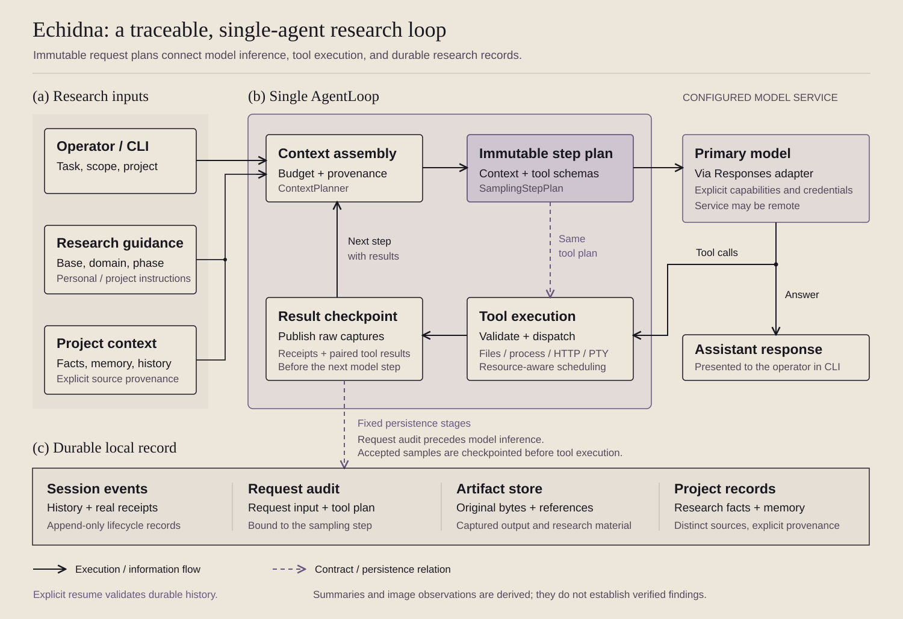

<p align="center">
  
</p>

<p align="center">
  <strong>简体中文</strong> · <a href="README.en.md">English</a>
</p>

<p align="center">
  <strong>在本地开展研究，让每一步都留下可追溯的依据。</strong>
</p>

<p align="center">
  <a href="#系统设计">系统设计</a> ·
  <a href="#能力">能力</a> ·
  <a href="#快速开始">快速开始</a> ·
  <a href="#日常使用">日常使用</a> ·
  <a href="#下一步">下一步</a> ·
  <a href="#文档">文档</a>
</p>

---

Echidna 是面向个人使用的本地优先漏洞研究 Agent。你给出目标、范围和问题，
它通过文件、命令行和网络工具推进分析，将会话、工具执行回执与研究材料保留在项目中，
支持继续研究、检查过程和导出记录。

项目由 Rust 实现，以交互式 CLI 为入口。源码、Web、移动端与二进制研究共用一个
AgentLoop；领域与阶段指导帮助组织研究方法，具体工具链由你的环境提供。

<a id="system-design"></a>

## 系统设计

Echidna 将单个研究 Agent 循环与可检查的本地工作记录结合起来。
用户定义任务和范围；运行时负责装配上下文、请求模型推理、执行通过校验的工具调用，
并保留继续研究或复查过程所需的观察记录。

[](docs/design/architecture-overview.svg)

*图 1. Echidna 的执行与持久化模型。(a) 用户输入、研究指导和项目上下文来自不同来源。
(b) 单个 AgentLoop 通过不可变采样计划关联模型推理与工具派发。
(c) 固定持久化阶段保留会话事件、请求审计、原始材料和项目记录。
图中省略了具体失败路径与可选图像路由，不包含未来的任务编排。*

**每次采样固定一份计划。** 上下文装配同时考虑来源信息与可用上下文预算。
`SamplingStepPlan` 将该上下文、向模型提供的工具 Schema 和显式模型能力绑定在一起。
同一份已解析工具计划负责校验和派发模型的工具调用，使模型可见的工具与实际可执行工具保持一致。

**先建立检查点，再开展依赖它的工作。** 请求审计先于模型推理；已接受的模型采样结果
先写入检查点，再执行依赖它的工具调用。原始进程输出先发布，再保存执行回执；
配对的工具结果先写入检查点，再进入下一次模型采样。工具执行在单个 Agent 循环中
按资源约束调度。

**保留观察记录，按需派生上下文。** 原始材料与只追加事件保留实际观察到的内容。
Memory、摘要、缓存和图像观察各自保留其用途与来源，不会自动成为已验证的发现。
显式恢复会话时，先校验持久化历史，再继续执行；未知的执行影响仍明确保持为未知。

这种分工让模型能力和研究方法可以持续演进，同时将执行、请求预算和恢复保留在本地控制之下。
配置辅助视觉 Provider 时，它在同一个 Agent 生命周期内通过受限的辅助路径工作。
运行时始终保持单个 AgentLoop 与统一的 Session 管理权。

## 能力

| | 可以做什么 |
| --- | --- |
| **分析与执行** | 搜索和读取代码，编辑文件、应用补丁，运行命令、发送 HTTP 请求，使用后台任务与 PTY。 |
| **持续研究** | 保留项目上下文与会话，显式恢复已有 Session；满足前提时压缩上下文，继续长任务。 |
| **随时介入** | 在终端中停止当前 Turn、补充指令或纠正方向，查看真实工具进度和输出。 |
| **回看依据** | 查看工具执行回执、原始材料引用与请求审计，导出 Markdown / JSON 会话记录。 |
| **积累方法** | 使用项目 Markdown Memory 和显式 Personal / Project 指导文件，保存约束、决策与失败路径。 |
| **图像辅助** | 按明确配置使用主模型或可选视觉模型处理图像，保留图像来源与观察关系。 |

**本地优先**指项目数据与工具执行位于本地；配置远端模型时，请求中的材料会发送给该 Provider。
图像支持取决于能力配置，模型观察和回答仍需用实际证据验证。

## 快速开始

当前主要面向 macOS。需要 Git 和 Rust/rustup；仓库通过
[`rust-toolchain.toml`](rust-toolchain.toml) 固定 Rust 1.93.1。
外部分析工具按任务需要自行准备。

### 1. 构建

```sh
git clone https://github.com/F0und-icu/echidna-agent.git
cd echidna-agent
cargo build --locked --release

ECHIDNA_BIN="$PWD/target/release/echidna"
"$ECHIDNA_BIN" --version
```

后续命令在同一个终端执行，继续使用 `ECHIDNA_BIN`。

### 2. 配置模型

将 [配置模板](docs/examples/provider.toml) 保存到代码仓库之外：

```sh
mkdir -p "$HOME/.config/echidna"
cp -n docs/examples/provider.toml "$HOME/.config/echidna/provider.toml"
chmod 600 "$HOME/.config/echidna/provider.toml"
```

编辑该文件，填写服务地址、模型与凭据，并按服务实际能力核对窗口和各项能力声明。
模板中的地址、密钥与 32K 窗口都是示例；`cp -n` 保留已有文件。
这里的路径由命令显式传入，程序不会自动发现它。

当前接入 **HTTP/SSE + Responses** 协议。Chat Completions 接口不适用。
凭据可使用本地 `api_key`，或改用 `CYBER_AGENT_*_API_KEY` 环境变量引用，二选一。
详细说明见 [Provider 配置](docs/development/DEVELOPMENT_ENVIRONMENT.md#61-应用级配置)。

### 3. 建立研究项目

```sh
mkdir -p ../echidna-research
cd ../echidna-research

"$ECHIDNA_BIN" init
"$ECHIDNA_BIN" --config "$HOME/.config/echidna/provider.toml" doctor
"$ECHIDNA_BIN" --config "$HOME/.config/echidna/provider.toml" chat
```

`doctor` 在本地检查配置，不发送模型请求，也不验证远端服务可达性；
进入 `chat` 提交任务后才使用所配置的模型。

在独立研究目录启动：工具使用当前用户权限执行，当前没有内置沙箱或执行确认层。

## 日常使用

查看历史会话，或者在新进程中继续最近的会话：

```sh
"$ECHIDNA_BIN" session list
"$ECHIDNA_BIN" --config "$HOME/.config/echidna/provider.toml" chat --resume latest
```

需要限定研究领域时，在 `chat` 后加 `--domain source|web|mobile|binary` 中的一个值，
例如 `chat --domain binary`。领域指导不会自动安装分析工具。

| 交互 | 行为 |
| --- | --- |
| `/stop` 或 Ctrl+C | 请求停止当前 Turn；已执行操作不会被撤销，后台任务需要单独处理。 |
| `/paste` | 按提示输入多行任务或补充材料。 |
| `/compact` | 在具备目标与研究记录等前提时压缩上下文。 |
| `/resume` | 在可恢复停止后显式重建模型会话，再输入任务。 |
| `/exit` | 离开交互界面。 |

导出指定会话，保留对过程和材料的引用：

```sh
# 将 SESSION_ID 替换为 session list 中的实际 ID。
"$ECHIDNA_BIN" session export SESSION_ID --format markdown --output session.md
```

终端回复以 **`Echidna>`** 开头。`NO_COLOR=1` 关闭主题颜色；
管道输出不会增加品牌欢迎或主题 ANSI。开发构建额外支持 `chat --debug`，
用于查看请求内容；标准 release 不包含此选项。

## 设计取向

**模型负责提出方法，工具负责执行，原始记录负责留下依据。**

Echidna 将执行、预算、Session 和恢复留在一个内核中。模型、研究指导与方法可以继续演进，
原始材料和执行记录为后续复查提供基础。项目设计保持小而明确，方便个人理解和维护。

当前入口是交互 CLI。TUI、机器 worker 入口、外部任务队列和独立 core SDK 均处于设计阶段。
网络中断恢复仍有 [待处理项](docs/development/R7_MANUAL_TEST_ISSUES.md)；
不承诺任意断流都能自动续传。

## 下一步

| 方向 | 目标 |
| --- | --- |
| 可靠性与交互 | 改善中断诊断、恢复提示、会话与后台任务的可见性。 |
| 可复用研究 | 更方便地定位证据、交接结果，从重复实践中整理方法。 |
| 外部并行 | 先验证独立目录与多进程的实际收益，再设计明确的机器入口和协调器。 |

这些是 [设计储备](docs/design/FUTURE_RESEARCH_DESIGN.md)，具体实施顺序由实际使用反馈决定。
[外部协调](docs/design/EXTERNAL_ORCHESTRATION.md) 独立于单个 Agent 内核演进。

## 文档

| 入口 | 内容 |
| --- | --- |
| [开发环境与配置](docs/development/DEVELOPMENT_ENVIRONMENT.md) | Provider、能力声明、构建与本地诊断 |
| [当前开发状态](docs/development/STATUS.md) | 已完成工作、验证记录与已知限制 |
| [架构与文档索引](docs/README.md) | 内核设计、决策记录与开发规范 |
| [品牌与主题](docs/design/ECHIDNA_IDENTITY.md) | 标志、配色与终端呈现 |
| [迁移记录](docs/development/ECHIDNA_MIGRATION.md) | 新旧仓库关系与兼容边界 |

<details>
<summary><strong>开发与验证</strong></summary>

默认验证使用离线 Mock / Fixture / Replay 及本地 loopback：

```sh
cargo fmt --all -- --check
cargo clippy --locked --all-targets --all-features -- -D warnings
cargo test --locked --all-targets --all-features
cargo build --locked
```

macOS arm64 本地分发：

```sh
./scripts/package-macos-arm64.sh
./tests/distribution_package.sh dist
```

完整 Gate 还包括 [Lean 治理检查](docs/development/LEAN_CODE_GOVERNANCE.md)。
Live 测试独立、显式启用；当前仓库 Actions 关闭。
工程验证和模型的实际研究表现分别记录，范围以 STATUS 为准。

</details>
