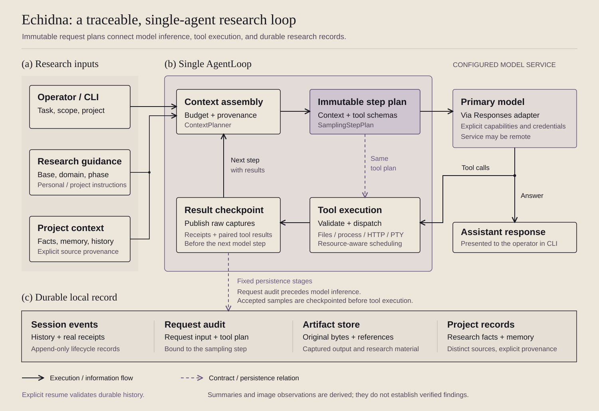

# Architecture and development

[Home](../README.en.md) · [简体中文](architecture.md)

[Design direction](#design-direction) · [Next steps](#next-steps) · [Development and verification](#development-and-verification)

---

Echidna couples a single research agent loop with an inspectable local record of its work.
The operator defines the task and scope; the runtime assembles context, requests model
inference, executes validated tool calls, and retains the observations needed to continue
or review the research.

[](../assets/architecture-overview.svg)

*Figure 1. Echidna's execution and persistence model. (a) Operator input, research guidance,
and project context enter through distinct sources. (b) One AgentLoop binds model inference
and tool dispatch to an immutable sampling plan. (c) Fixed persistence stages retain session
events, request audits, original artifacts, and project records. The figure abstracts
individual failure paths and optional image routing; it does not depict future orchestration.*

**Plan once per sampling step.** Context assembly accounts for source provenance and the
available context budget. A captured `SamplingStepPlan` binds that context to the advertised
tool schemas and explicit model capabilities. The same resolved tool plan validates and
dispatches the model's tool calls, keeping model-visible tools and executable tools aligned.

**Checkpoint before dependent work.** Request auditing precedes inference. Accepted model
samples are checkpointed before dependent tool execution; raw process captures are published
before execution receipts, and paired tool results are checkpointed before the next model
step. Tool execution uses resource-aware scheduling inside the single agent loop.

**Retain observations; derive context.** Original artifacts and append-only events preserve
what was observed. Memory, summaries, caches, and image observations retain their own roles
and provenance; none automatically establishes a verified finding. Explicit session recovery
validates durable history before continuing, while unknown execution effects remain explicit.

This separation lets model capabilities and research methods evolve while execution,
request budgets, and recovery remain locally controlled. When configured, a secondary vision
provider follows a scoped auxiliary path within the same agent lifecycle. The runtime keeps
one agent loop and one session authority.

## Design direction

**Models propose methods. Tools execute them. Original records preserve the basis for review.**

Echidna keeps execution, budgets, sessions, and recovery in one core. Models, research
guidance, and methods can continue to evolve; original materials and execution records
provide a basis for later review. The project stays small and explicit so one person can
understand and maintain it.

The current entrypoint is an interactive CLI. A TUI, a machine-facing worker interface,
external task queues, and a standalone core SDK remain at the design stage.
Network recovery is limited to the [bounded retries of incomplete model requests](../guides/runtime.en.md);
tool execution retains its existing outcome and recovery rules.

## Next steps

| Direction | Aim |
| --- | --- |
| Reliability and interaction | Improve interruption diagnostics, recovery guidance, and visibility into sessions and background jobs. |
| Reusable research | Make evidence and results easier to locate and hand off, and distill methods from repeated practice. |
| External parallelism | First validate the benefits of separate directories and processes, then design an explicit machine interface and coordinator. |

These directions remain at the planning stage; implementation order will follow feedback
from actual use. External orchestration evolves independently of the single-agent core.

## Development and verification

Default verification uses offline Mock / Fixture / Replay providers and local loopback:

```sh
cargo fmt --all -- --check
cargo clippy --locked --all-targets --all-features -- -D warnings
cargo test --locked --all-targets --all-features
cargo build --locked
```

Local distribution for macOS arm64:

```sh
./scripts/package-macos-arm64.sh
./tests/distribution_package.sh dist
```

Live tests are separate and must be explicitly enabled; repository Actions are currently disabled.
Passing engineering checks does not establish that the model can correctly complete every
research task.
