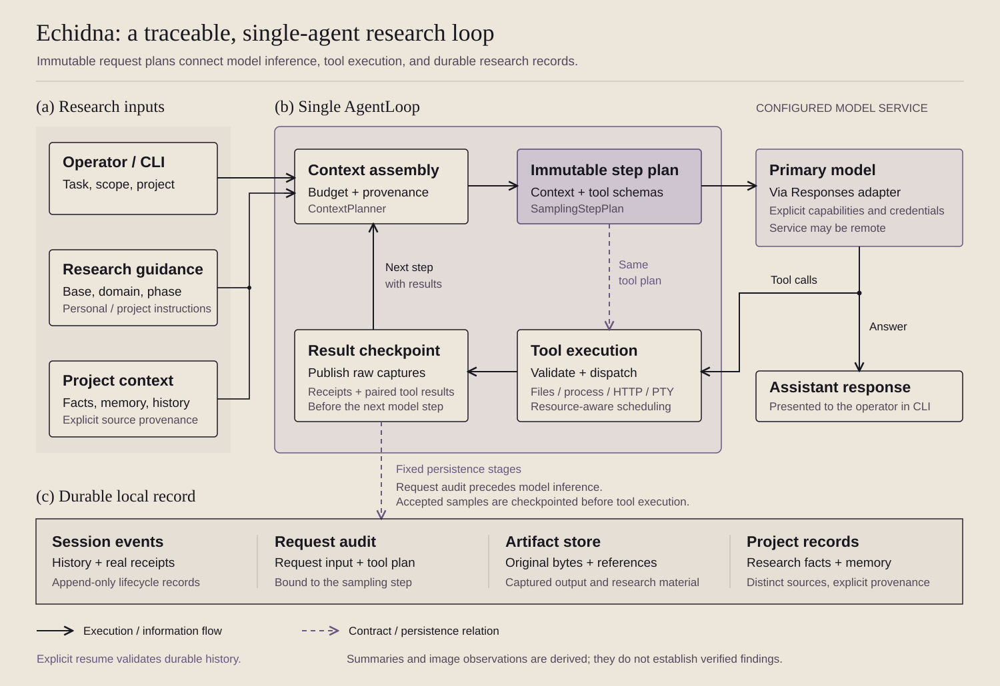

# 架构与开发

[返回首页](../README.md) · [English](architecture.en.md)

[设计取向](#设计取向) · [下一步](#下一步) · [开发与验证](#开发与验证)

---

Echidna 将单个研究 Agent 循环与可检查的本地工作记录结合起来。
用户定义任务和范围；运行时负责装配上下文、请求模型推理、执行通过校验的工具调用，
并保留继续研究或复查过程所需的观察记录。

[](../assets/architecture-overview.svg)

*图 1. Echidna 的执行与持久化模型。(a) 用户输入、研究指导和项目上下文来自不同来源。
(b) 单个 AgentLoop 通过不可变采样计划关联模型推理与工具派发。
(c) 固定持久化阶段保留会话事件、请求审计、原始材料和项目记录。
图中省略了具体失败路径与可选图像路由，不包含未来的任务编排。*

**每次采样固定一份计划。** 上下文装配同时考虑来源信息与可用上下文预算。
`SamplingStepPlan` 将该上下文、向模型提供的工具 Schema 和显式模型能力绑定在一起。
同一份已解析工具计划负责校验和派发模型的工具调用，使模型可见的工具与实际可执行工具保持一致。

**先建立检查点，再开展依赖它的工作。** 请求审计先于模型推理；已接受的模型采样结果
先写入检查点，再执行依赖它的工具调用。原始进程输出先发布，再保存执行回执；
配对的工具结果先写入检查点，再进入下一次模型采样。工具执行在单个 Agent 循环中
按资源约束调度。

**保留观察记录，按需派生上下文。** 原始材料与只追加事件保留实际观察到的内容。
Memory、摘要、缓存和图像观察各自保留其用途与来源，不会自动成为已验证的发现。
显式恢复会话时，重建持久化状态并校验最近任务来源及当前依赖，不逐次重建所有旧请求链；
全历史请求校验保留在显式审计路径。恢复不会重跑旧任务或工具，未知的执行影响仍保持为未知。
对话期间复用会话投影并增量更新索引；临时索引采用批量写入和内存计数。
正常历史按程序追加管理，不反复读取旧前缀以防人为改写。
任务卡和活动约束引用的历史来源会同时提供可选摘录，保留原有检索结果与历史回放。

这种分工让模型能力和研究方法可以持续演进，同时将执行、请求预算和恢复保留在本地控制之下。
配置辅助视觉 Provider 时，它在同一个 Agent 生命周期内通过受限的辅助路径工作。
运行时始终保持单个 AgentLoop 与统一的 Session 管理权。

## 设计取向

**模型负责提出方法，工具负责执行，原始记录负责留下依据。**

Echidna 将执行、预算、Session 和恢复留在一个内核中。模型、研究指导与方法可以继续演进，
原始材料和执行记录为后续复查提供基础。项目设计保持小而明确，方便个人理解和维护。

当前入口是交互 CLI。TUI、机器 worker 入口、外部任务队列和独立 core SDK 均处于设计阶段。
网络恢复限于[运行指南](../guides/runtime.md)所述未完成模型请求的有限重试，工具执行保持原有结果与恢复规则。

## 下一步

| 方向 | 目标 |
| --- | --- |
| 可靠性与交互 | 改善中断诊断、恢复提示、会话与后台任务的可见性。 |
| 可复用研究 | 更方便地定位证据、交接结果，从重复实践中整理方法。 |
| 外部并行 | 先验证独立目录与多进程的实际收益，再设计明确的机器入口和协调器。 |

这些方向尚处于规划阶段，具体实施顺序由实际使用反馈决定。
外部协调独立于单个 Agent 内核演进。

## 开发与验证

默认验证使用离线 Mock / Fixture / Replay 及本地 loopback：

```sh
cargo fmt --all -- --check
cargo clippy --locked --all-targets --all-features -- -D warnings
cargo test --locked --all-targets --all-features
cargo build --locked
```

macOS arm64 本地分发：

```sh
./scripts/package-macos-arm64.sh
./tests/distribution_package.sh dist
```

Live 测试独立、显式启用；当前仓库 Actions 关闭。
工程检查通过不代表模型在所有研究任务中都能正确完成工作。
