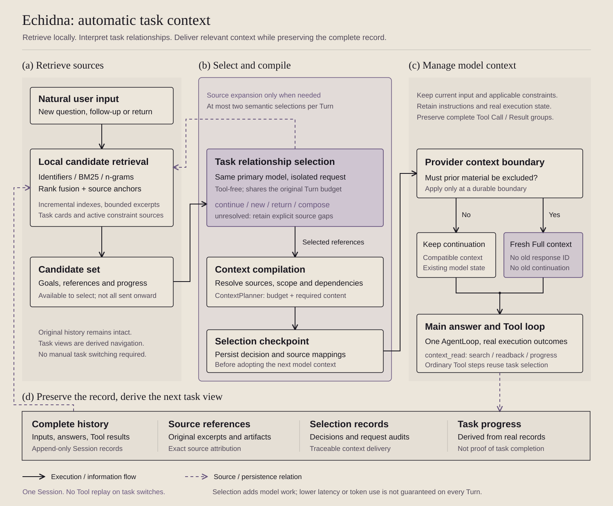

# Automatic task context

[Home](../README.en.md) · [简体中文](task-context.md)

---

Ask a new question, follow up or return to an earlier task naturally in the same
Chat, without creating tasks, switching Sessions or confirming classifications.
The harness manages context for each request while keeping the complete history
in one Session. Task cards describe goals and sources; progress is derived from
existing records. Neither starts work autonomously or proves that work is complete.

The algorithm has three stages: **retrieve candidates locally → classify task
relationships with the model → compile context from referenced sources**. Local
retrieval bounds the candidate set. An isolated, tool-free request to the same
primary model interprets intent and dependencies. The harness resolves references,
includes dependencies and required content, and uses the existing ContextPlanner
to budget the final input.

*Figure 2. Normal automatic task-context flow. Reference, capacity and persistence
failures use the existing error paths. Expansion is bounded source retrieval,
not arbitrary retries of invalid decisions. Remaining gaps stay explicit.*

**Candidates and delivered context are distinct.** The local index reuses identifier
matching, BM25, character n-grams and rank fusion to provide bounded candidates and
source excerpts. Original sources referenced by task cards and active constraints
are also selectable. A candidate is not automatically delivered to the main request:
only selected and required material enters its context. Indexes update incrementally;
task switches do not delete or rewrite historical text.

**Relationships follow goals and dependencies.** The same entity can appear in
different tasks; a new entity can still use an earlier method. These examples describe
intended interactions; the configured model still makes the semantic judgment:

| Current input | Relationship | Context behavior |
| --- | --- | --- |
| “Explain the valuation assumptions further.” | `continue` | Keep relevant material and progress for the current task. |
| After analyzing Zhongji Innolight, independently analyze today's first-limit-up weak-to-strong setups. | `new` | Create a new task view without carrying over the previous task's full text merely because it was adjacent. |
| “Return to the Zhongji Innolight analysis.” | `return` | Retrieve the earlier task and relevant sources without rerunning tools. |
| “Compare these results using the earlier screening method.” | `compose` | Combine required tasks and method sources while retaining attribution. |
| “Continue with that method,” with no clear source. | `unresolved` | Record the gap and expand sources within the budget; do not invent references. |

**Task switching also manages model continuation.** Removing local messages cannot
exclude content still present in a Provider continuation chain. When prior material
must be excluded, the harness establishes a fresh context at a durable boundary and
sends a Full request. Compatible worksets retain continuation. A switch does not
reset the Turn budget, replay tools or cancel background work. Persona, work and
method instructions remain whole; global constraints, required material with uncertain
scope, and actual execution state remain protected. The read-only `context_read` tool
can search sources, expand exact references and read progress within the bound project
and Agent.

**Request cost.** A new input normally adds one tool-free selection request, including
the first input. Ordinary Tool continuations within the same Turn do not each require
reclassification. Explicit gaps or attribution corrections allow at most two semantic
selections per Turn.
Every actual request and retry uses the existing shared admission budget,
reserving one admission for the main request. One selection plus one main
request needs two admissions; images, Tool continuations and retries cost more.
Short questions may take longer because of the control request. Lower latency or
token use is not guaranteed on every Turn; gains depend on history size, the share
of relevant material and selection quality. Actual reported cached usage and request
counts remain available in the existing local records.

Selection depends on the configured model's judgment; correct the intent in
ordinary language when necessary. Task changes preserve real Tool outcomes and
background work. Stops requiring recovery retain the existing `/resume` flow.
Older binaries cannot Resume Sessions containing the new task-context events.

Implementation: [candidates and task projections](../src/domain/session/task_context.rs),
[selection and context compilation](../src/app/agent_loop/task_context_sample.rs),
[Session integration and Resume](../src/cli_chat/task_context.rs).

Normal Resume rebuilds durable state and verifies the latest task sources and
current dependencies without reconstructing every retired Provider request chain.
Explicit historical audit retains full verification. Resume never retries old
inputs or tools and never resolves unknown execution effects by assumption.
Active conversations reuse the Session projection and incrementally batch index
updates with in-memory counts. Harness-owned history is treated as append-only;
old prefixes are not reread to detect manual rewrites. Task cards and active
constraints include selectable excerpts of their original History sources;
ranked retrieval results and historical replay remain available.
