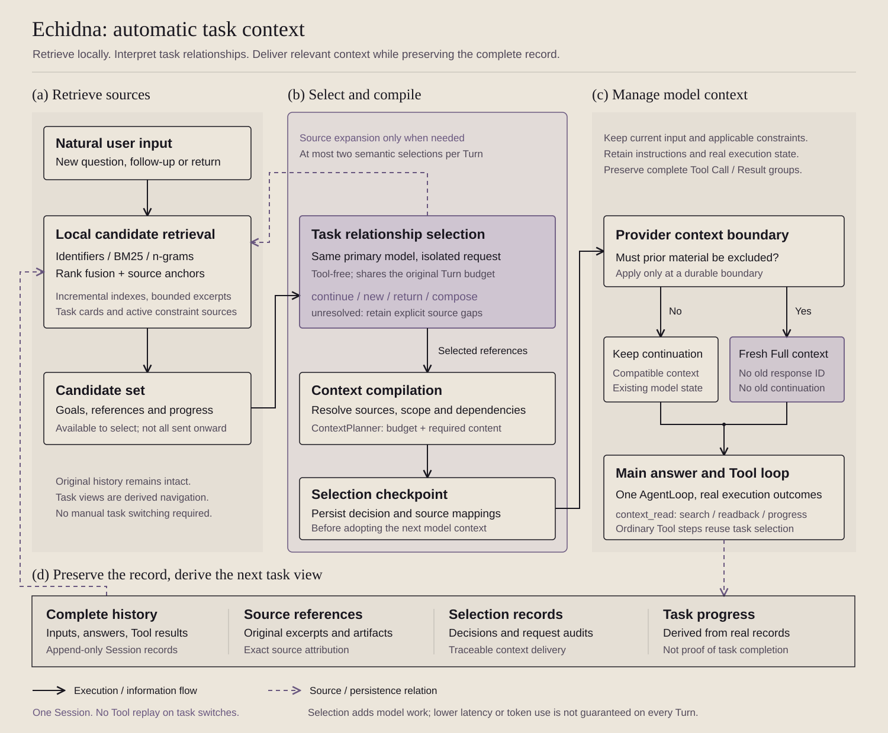

# 自动任务上下文

[返回首页](../README.md) · [English](task-context.en.md)

---

在同一 Chat 中自然提出新问题、追问或返回旧任务即可，无需手动建任务、切换会话或
确认分类。Harness 自动管理当前请求使用的上下文，完整历史仍保存在同一个 Session。
任务卡记录目标与来源，任务进度从已有记录派生；它们用于选择材料，不会自行启动任务
或将模型判断当作已完成工作的证明。

算法分为三步：**本地检索候选 → 模型判断任务关系 → 按来源编译当前上下文**。
本地检索缩小选择范围；同一主模型的独立无工具请求判断意图和依赖；Harness 负责
解析引用、补齐依赖、保留必需内容，并通过原有 ContextPlanner 控制最终输入预算。

*图 2. 自动任务上下文的正常处理流程。引用、容量或持久化失败沿原错误路径报告；
图中的补读是有界来源扩展，不是对无效选择的任意重试。仍未解决的缺口保持显式记录。*

**候选检索与最终发送分开。** 本地索引复用标识匹配、BM25、字符 n-gram 和排名融合，
提供有界候选与来源摘录。任务卡和活动约束指向的原始来源也会进入可选范围，避免只看到
引用却无法选取正文。进入候选不等于发送给主请求：只有选中的材料及必须保留的内容
进入最终上下文。索引增量更新，历史正文不会因为任务切换被删除或重写。

**按目标和依赖判断关系。** 出现同一个名称不必然属于同一任务，换了研究对象也不必然
意味着旧方法失效。以下是预期交互示例，具体分类仍由配置的模型判断：

| 当前输入 | 关系 | 上下文处理 |
| --- | --- | --- |
| “继续解释刚才的估值假设” | `continue` | 保留当前任务相关材料与进度。 |
| 分析中际旭创后，提出独立的“今日首板弱转强”分析 | `new` | 建立新任务视图，不因相邻对话就带入前一任务全文。 |
| “回到刚才的中际旭创分析” | `return` | 找回原任务及相关来源，不重跑旧工具。 |
| “按前面的筛选方法比较这两个结果” | `compose` | 组合所需任务与方法来源，保留各自归属。 |
| “照那个方法继续”，但来源不明确 | `unresolved` | 记录缺口，在额度内扩展来源；不编造引用。 |

**任务切换同时管理模型续接。** 仅从本地列表删掉旧消息，无法排除 Provider 续接链中的
旧内容。需要排除旧材料时，Harness 在结果已持久化的边界建立新上下文并发送 Full 请求；
兼容的工作集继续沿用原续接。任务切换不重置本轮请求额度、不重放工具，也不取消后台工作。
人格、工作和方法指令保持完整；全局约束、归属尚不明确的必需内容及真实执行状态继续保留。
模型还可使用只读 `context_read` 搜索来源、读取精确引用或任务进度，范围绑定当前项目和人格。

**请求成本。** 普通新输入通常增加一次无工具的选择请求，首条输入也会选择；同一轮的
普通工具续接不需要逐次重新分类。有明确缺口或归属纠正时，一轮最多两次语义选择。
每个实际请求及其重试都计入原有共享额度，并为主请求保留一次额度。
一次选择加一次主请求需要两次额度，图像、工具续接和重试另计。短问题可能因控制
请求增加延迟；这项机制不保证每轮更快或 Token 更少，实际收益取决于历史规模、相关材料
比例和模型选择质量。缓存用量和请求次数可查看现有本地记录。

选择仍依赖所配置模型的判断；可直接用自然语言更正意图。任务切换保留真实工具结果
和后台工作状态。发生需要恢复的停止时，继续使用既有 `/resume` 流程。
旧二进制不能恢复包含新任务上下文事件的 Session。

实现入口：[候选与任务投影](../src/domain/session/task_context.rs)、
[选择与上下文编译](../src/app/agent_loop/task_context_sample.rs)、
[Session 接入与恢复](../src/cli_chat/task_context.rs)。
